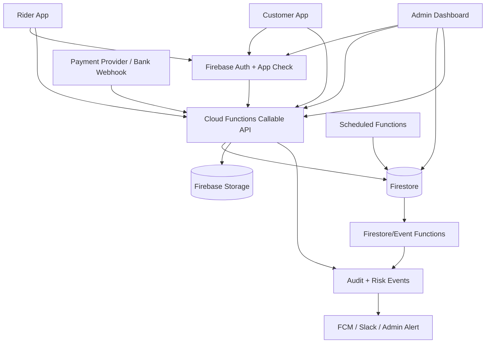
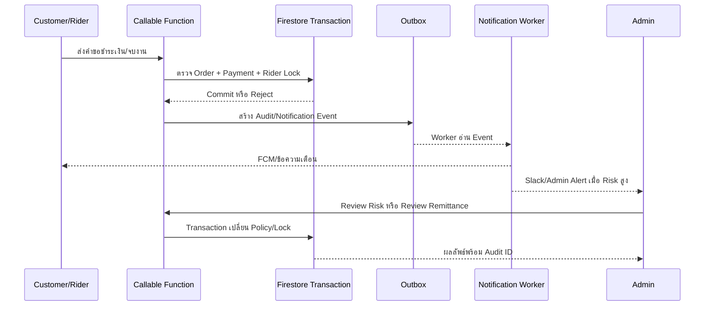

# สถาปัตยกรรมระบบป้องกันการจ่ายเงินนอกระบบและการบล็อกไรเดอร์อัตโนมัติ

เอกสารฉบับนี้ออกแบบให้ต่อยอดจากระบบ ChauatGo ปัจจุบัน ซึ่งใช้ Firebase Authentication, Firestore, Cloud Functions 2nd gen, Firebase Storage, App Check และ Rider/Admin Web UI

## 1. เป้าหมายและขอบเขต

### เป้าหมาย

1. ป้องกันไม่ให้ Client ปลอมราคา สถานะการชำระเงิน หรือสถานะจบงาน
2. บังคับให้เหตุการณ์ทางการเงินที่สำคัญเกิดผ่าน Cloud Functions เท่านั้น
3. ลดโอกาสที่ Rider และ Customer จะตกลงจ่ายเงินนอกระบบ
4. ตรวจจับสัญญาณเสี่ยง เช่น การแลกเบอร์โทร การส่งช่องทางภายนอก การยกเลิกหลังรับงาน และการจบงานโดยไม่มี Payment Event
5. บล็อกหรือจำกัด Rider อัตโนมัติตาม Policy ที่ตรวจสอบย้อนกลับได้
6. ให้ Admin ตรวจสอบและอุทธรณ์ได้ โดยไม่ให้การตรวจจับที่ผิดพลาดทำให้ Rider ถูกแบนถาวรโดยอัตโนมัติ

### ข้อจำกัดที่ต้องยอมรับ

ระบบไม่สามารถรับประกันได้ 100% ว่าจะป้องกันการตกลงกันนอกระบบ หากคนสองฝ่ายตั้งใจแลกข้อมูลกันเอง ดังนั้นสถาปัตยกรรมควรใช้หลายชั้นร่วมกัน ได้แก่ Server enforcement, Chat filtering, Payment verification, Risk scoring, Audit และ Incentive

หากระบบยังใช้การแนบสลิปและให้แอดมินตรวจด้วยมือ ระบบจะยืนยันได้ว่า “มีหลักฐานการโอนเข้าบัญชีระบบ” แต่ยังไม่ใช่การยืนยัน Payment แบบ real-time จากธนาคาร จนกว่าจะเชื่อมต่อ Payment Provider หรือ Bank API ที่มี Webhook

---

## 2. หลักการออกแบบ

### 2.1 Server เป็นเจ้าของข้อมูลทางการเงิน

Client ห้ามเขียนหรือกำหนดค่าต่อไปนี้โดยตรง:

- `fare`
- `total`
- `riderIncome`
- `riderOwe`
- `riderPaid`
- `paymentStatus`
- `completedAt`
- `platformFee`
- `riskScore`
- `onlineLockedUntil`
- `lockReason`

Client ทำได้เพียงส่งคำขอ เช่น `completeOrder`, `submitPaymentProof` หรือ `confirmCashReceived` จากนั้น Cloud Function จะอ่านข้อมูลจริงจาก Firestore, ตรวจ State Machine, คำนวณยอดใหม่ และเขียนผลลัพธ์ด้วย Transaction

### 2.2 ทุกการเปลี่ยนสถานะต้องมี Precondition

ตัวอย่างเช่น ไม่อนุญาตให้เปลี่ยนจาก `assigned` ไป `completed` โดยตรง ต้องผ่านเหตุการณ์ที่กำหนดก่อน:

```text
assigned
  -> rider_started
  -> arrived_pickup
  -> picked_up
  -> arrived_customer
  -> payment_pending / cash_to_collect
  -> payment_verified / cash_confirmed
  -> completed
```

หากเหตุการณ์ก่อนหน้าไม่ครบ ให้ตอบ `failed-precondition` และไม่เขียนข้อมูล

### 2.3 ใช้ Idempotency ทุกคำสั่งการเงิน

แต่ละคำขอต้องมี `idempotencyKey` ที่ไม่ซ้ำในขอบเขตของ User และ Order เช่น:

```text
payment:{orderId}:{clientRequestId}
complete:{orderId}:{attemptId}
remittance:{riderId}:{dateKey}
```

การกดซ้ำ, Network retry หรือ Cloud Function retry ต้องไม่สร้าง Payment หรือ Remittance ซ้ำ

### 2.4 Auto-block ต้องเป็น Policy ที่อธิบายได้

ไม่ควรล็อกถาวรจากสัญญาณเดียว เช่น GPS ผิดพลาดหรือคำแชทคำเดียว ควรแบ่งระดับ:

```text
normal       0–39 คะแนน
watch        40–69 คะแนน
review       70–89 คะแนน
restricted   90–100 คะแนน
```

การพักรับงานชั่วคราวทำได้อัตโนมัติเมื่อมีเงื่อนไขชัดเจน ส่วนการปิดบัญชีถาวรต้องผ่าน Admin Review และมี Audit Log

---

## 3. สถาปัตยกรรม Logical



### Trust Boundary

```text
Untrusted: Rider App, Customer App, Browser, uploaded metadata
Trusted: Cloud Functions, Firestore Rules, Payment Webhook, Admin-authenticated callable
Restricted: Firestore private subcollections, audit collections, risk profiles
```

---

## 4. Firestore Data Model

### 4.1 `orders/{orderId}`

เอกสาร Order เป็นข้อมูลหลักของงาน แต่ Client ไม่ควรแก้ฟิลด์ทางการเงินหรือ Completion โดยตรง

```javascript
{
  riderId: "riderUid",
  customerId: "customerUid",
  status: "payment_pending",
  serviceType: "ride",
  fare: 120,
  platformFee: 24,
  riderIncome: 96,
  paymentMode: "online",
  paymentStatus: "pending",
  paymentRequiredAmount: 120,
  paymentVerifiedAt: null,
  completedAt: null,
  currentEventVersion: 7,
  assignedAt: Timestamp,
  updatedAt: Timestamp
}
```

ฟิลด์ที่ควรเป็น Server-owned:

```text
fare, total, platformFee, riderIncome, riderPaid,
paymentStatus, paymentVerifiedAt, completedAt,
currentEventVersion, riskLevel, riskScore
```

### 4.2 `orders/{orderId}/events/{eventId}`

เก็บ State Transition แบบ Append-only เพื่อใช้ตรวจสอบย้อนหลัง

```javascript
{
  type: "payment_verified",
  orderId: "orderId",
  actorId: "system-or-uid",
  actorRole: "function",
  previousStatus: "payment_pending",
  nextStatus: "completed",
  idempotencyKey: "complete:orderId:abc",
  source: "payment_webhook",
  metadata: {
    provider: "provider-name",
    paymentId: "provider-payment-id"
  },
  createdAt: Timestamp
}
```

Client อาจอ่าน Event ที่จำเป็นสำหรับ Order ของตนได้ แต่ไม่ควรแก้ไขหรือลบ Event

### 4.3 `payments/{paymentId}`

ใช้เป็น Ledger ทางการเงินของ Order

```javascript
{
  orderId: "orderId",
  payerId: "customerUid",
  riderId: "riderUid",
  amountExpected: 120,
  amountReceived: 120,
  currency: "THB",
  method: "provider_qr",
  status: "pending", // pending | submitted | verified | rejected | refunded
  provider: "provider-name",
  providerTransactionId: "...",
  proofPath: "payments/orderId/proof.jpg",
  verifiedBy: "adminUid-or-system",
  verifiedAt: Timestamp,
  createdAt: Timestamp,
  updatedAt: Timestamp
}
```

ถ้าเป็นการแนบสลิปแบบ Manual ให้ `status=submitted` จนกว่า Admin จะตรวจผ่าน ห้ามตั้ง `verified` จาก Client

### 4.4 `payment_intents/{intentId}`

ใช้กันการสร้าง QR หรือ Intent ซ้ำ

```javascript
{
  orderId: "orderId",
  payerId: "customerUid",
  amount: 120,
  currency: "THB",
  status: "created",
  expiresAt: Timestamp,
  providerReference: "...",
  idempotencyKey: "payment:orderId:requestId",
  createdAt: Timestamp
}
```

### 4.5 `rider_remittances/{riderId_dateKey}`

รูปแบบนี้สอดคล้องกับระบบเดิมที่ใช้ Deterministic ID ต่อ Rider ต่อรอบวัน

```javascript
{
  riderId: "riderUid",
  dateKey: "2026-11-20",
  amountExpected: 20.20,
  amountSubmitted: 40.00,
  overpaidAmount: 19.80,
  status: "pending", // pending | verified | rejected
  slipPath: "settlement_slips/riders/uid/2026-11-20.jpg",
  verifiedBy: "adminUid",
  verifiedAt: Timestamp,
  jobIds: ["orderA", "orderB"],
  idempotencyKey: "remittance:riderUid:2026-11-20",
  createdAt: Timestamp,
  updatedAt: Timestamp
}
```

หลักสำคัญคือ `amountExpected` ต้องคำนวณจาก Order ฝั่ง Server และ `amountSubmitted` ต้องมาจากข้อมูลสลิป/Provider ไม่ควรใช้ยอดสลิปแทนยอดค้าง

### 4.6 `riders/{riderId}`

เก็บสถานะปัจจุบันที่ UI ต้องใช้ แต่ค่า Lock ต้องเขียนจาก Server เท่านั้น

```javascript
{
  status: "active",
  verified: true,
  onlineLockedUntil: Timestamp,
  onlineLockReason: "remit_verified_cooldown",
  remittanceVerificationUntil: Timestamp,
  riskScore: 48,
  riskLevel: "watch",
  restriction: "none", // none | monitor | restricted | suspended
  lastRiskEventAt: Timestamp,
  updatedAt: Timestamp
}
```

แนะนำแยกข้อมูลละเอียดออกเป็น `riders/{riderId}/private/security` เพื่อไม่เปิดเผย Risk Evidence ให้ Rider เห็นทั้งหมด

### 4.7 `risk_events/{eventId}`

```javascript
{
  riderId: "riderUid",
  customerId: "customerUid",
  orderId: "orderId",
  type: "contact_exchange_detected",
  scoreDelta: 35,
  severity: "medium",
  evidence: {
    channel: "order_chat",
    pattern: "phone_number",
    redacted: true
  },
  status: "open", // open | reviewed | dismissed | actioned
  createdAt: Timestamp,
  reviewedAt: Timestamp,
  reviewedBy: "adminUid"
}
```

ห้ามเก็บข้อความส่วนตัวแบบเต็มใน Risk Event ถ้าไม่จำเป็น ควรเก็บเฉพาะ Pattern ที่พบและข้อความที่ Mask แล้ว

### 4.8 `audit_logs/{auditId}`

Append-only สำหรับการเปลี่ยนแปลงสำคัญ:

```javascript
{
  actorId: "uid-or-system",
  actorRole: "function | admin | rider | customer",
  action: "rider_lock_created",
  targetType: "rider",
  targetId: "riderUid",
  orderId: "orderId",
  reasonCode: "remittance_overdue",
  before: { status: "active" },
  after: { status: "restricted" },
  requestId: "...",
  createdAt: Timestamp
}
```

ห้ามให้ Browser ลบหรือแก้ Audit Log

### 4.9 `outbox/{eventId}`

ใช้แยก Transaction ทางธุรกิจกับการส่ง Notification

```javascript
{
  type: "rider_restricted",
  aggregateType: "rider",
  aggregateId: "riderUid",
  payload: { reasonCode: "off_platform_payment_risk" },
  status: "pending", // pending | sent | failed
  attempts: 0,
  nextAttemptAt: Timestamp,
  createdAt: Timestamp
}
```

ห้ามส่ง Slack/FCM ภายใน Transaction เดียวกับ Firestore โดยตรง เพราะการส่งภายนอกอาจล้มเหลวหรือถูก Retry ซ้ำ ควรเขียน Outbox ก่อน แล้วให้ Worker/Scheduler ส่งแบบ Idempotent

---

## 5. Cloud Functions ที่แนะนำ

### 5.1 Callable Functions สำหรับธุรกรรม

#### `createPaymentIntent`

หน้าที่:

1. ตรวจ Auth และ App Check
2. ตรวจว่า Customer เป็นเจ้าของ Order
3. ตรวจสถานะ Order ว่ายังชำระได้
4. คำนวณยอดจาก Order ฝั่ง Server
5. สร้าง `payment_intents` ด้วย Idempotency
6. คืน QR หรือ Provider Reference

#### `submitPaymentProof`

หน้าที่:

1. ตรวจว่า Payment Intent ยังไม่หมดอายุ
2. ตรวจ Storage Path ว่าเป็นของ User และ Order ที่ถูกต้อง
3. สร้างหรืออัปเดต Payment เป็น `submitted`
4. สร้าง Audit Log
5. ไม่เปลี่ยนเป็น `verified` เอง

#### `confirmCashReceived`

หน้าที่:

1. ตรวจ Rider ถูกมอบหมายให้ Order
2. ตรวจสถานะต้องอยู่ที่ `arrived_customer` หรือ State ที่กำหนด
3. คำนวณยอดที่ต้องรับใหม่จาก Order
4. เก็บจำนวนเงินที่แจ้งว่ารับจริง
5. ให้ Customer ยืนยันซ้ำ หรือเข้า Manual Review หากยอดไม่ตรง

#### `verifyPayment`

ใช้โดย Admin หรือ Provider Webhook เท่านั้น

1. อ่าน Payment และ Order ใน Transaction เดียวกัน
2. ตรวจจำนวนเงินและ Order Reference
3. เปลี่ยน Payment เป็น `verified`
4. เปลี่ยน Order ไป State ถัดไป
5. สร้าง `orders/{orderId}/events`
6. สร้าง Audit และ Outbox

#### `completeOrder`

ห้ามจบงานหาก:

- Payment ยังไม่ `verified`
- เงินสดยังไม่ `confirmed`
- ไม่มี Completion Token
- Rider ไม่ใช่ผู้ได้รับมอบหมาย
- Order Version ไม่ตรงกับ Client
- Rider อยู่ในสถานะ Restricted จากเหตุที่ห้ามจบงาน

#### `submitRiderRemittance`

ใช้ Deterministic ID แบบปัจจุบัน:

```text
rider_{riderId}_{dateKey}
```

ต้องคำนวณ `amountExpected` จาก Orders ใน Transaction และรองรับการ Retry โดยไม่สร้างรายการซ้ำ

#### `reviewRiderRemittance`

เมื่อ Admin อนุมัติ:

1. อ่าน Remittance, Rider และ Orders ใน Transaction
2. ตรวจยอดตาม Server calculation
3. ทำเครื่องหมายเฉพาะ `jobIds` ที่อยู่ในรอบนั้นเป็น `riderPaid=true`
4. บันทึก `amountSubmitted`, `amountExpected`, `overpaidAmount`
5. สร้าง Cooldown ตาม Policy
6. เขียน Audit Log และ Outbox

#### `reviewRiskCase`

Admin ใช้ตรวจ Risk Case:

- `dismiss`: ไม่พบความผิด
- `monitor`: เฝ้าระวัง
- `restrict`: พักรับงานชั่วคราว
- `suspend`: ระงับตาม Policy
- `clear`: ปลด Risk Restriction หลังตรวจสอบ

### 5.2 Firestore Event Functions

#### `onOrderWritten`

ทำหน้าที่:

- สร้าง Rider-safe History
- Sync Merchant Inbox
- ตรวจการเปลี่ยน State ที่ผิดปกติ
- อัปเดต Settlement Queue
- ห้ามสร้าง `riderPaid=false` ทับค่า `true` เดิม

#### `onPaymentWritten`

ทำหน้าที่:

- ตรวจ Transition ของ Payment
- สร้าง Risk Event เมื่อมีการส่งหลักฐานซ้ำหรือยอดไม่ตรง
- สร้าง Outbox สำหรับ Notification

#### `onChatMessageCreated`

ทำหน้าที่:

- ตรวจเบอร์โทร, LINE, Social URL, QR หรือคำสั่งให้โอนนอกระบบ
- Mask ข้อมูลก่อนเผยแพร่ หรือปฏิเสธข้อความตาม Severity
- สร้าง Risk Event หากพบ Pattern
- ส่งข้อความเตือนแบบไม่เปิดเผยรายละเอียดการตรวจจับ

#### `onRiderRemittanceReviewed`

ถ้าแยกจาก Callable ได้ ให้ใช้เป็น Audit/Notification Worker โดยอ่านสถานะที่ Commit แล้ว ไม่ทำธุรกรรมซ้ำกับ Review Transaction

### 5.3 Scheduled Functions

#### `sweepRiderRemit`

ทำหน้าที่:

- คำนวณยอดรอบปัจจุบันใหม่
- ตรวจ Lock ที่หมดอายุ
- ล้าง Lock เฉพาะเมื่อไม่มี Cooldown หรือ Restriction อื่น
- สร้าง Lock หลังพ้น Deadline ตาม Policy
- ไม่ล้าง Lock ของ Risk/Safety จากการคำนวณ Remittance

#### `processRiskSignals`

รวมสัญญาณในช่วงเวลา เช่น:

- Chat Risk Event
- ยกเลิกหลังรับงาน
- Payment mismatch
- GPS/Order Event mismatch
- คู่ Rider–Customer ที่ซ้ำผิดปกติ

จากนั้นคำนวณ Risk Score แบบ Idempotent

#### `processOutbox`

ส่ง FCM, Slack หรือ Admin Notification โดยใช้ `eventId` เป็น Deduplication Key

---

## 6. Lock State Machine

ไม่ควรใช้ฟิลด์เดียวตัดสิน Lock เพราะ Rider อาจถูกล็อกจากหลายสาเหตุ ควรแยกเป็น Policy Components:

```javascript
{
  remitLockUntil: Timestamp,
  verificationCooldownUntil: Timestamp,
  riskRestrictionUntil: Timestamp,
  safetySuspensionUntil: Timestamp
}
```

แล้วมี Function คำนวณ Effective Lock:

```text
effectiveUntil = max(
  remitLockUntil,
  verificationCooldownUntil,
  riskRestrictionUntil,
  safetySuspensionUntil
)
```

`onlineLockedUntil` อาจเก็บเป็นค่าที่คำนวณล่าสุดเพื่อให้ UI อ่านง่าย แต่ Source of Truth ต้องมาจาก Policy Components

### ตัวอย่าง Policy

```text
ยอดค้างหลัง 22:00              -> remit_lock 24 ชั่วโมง
Admin ตรวจสลิปผ่าน              -> verification_cooldown 24 ชั่วโมง
พบการส่งเบอร์ซ้ำระดับสูง        -> risk_restriction 24 ชั่วโมง + Admin Review
Payment mismatch ซ้ำ 3 ครั้ง    -> risk_restriction 48 ชั่วโมง
Suspension ถาวร                 -> Admin เท่านั้น
```

เมื่อยอดค้างกลายเป็น `0` ห้ามล้าง `verificationCooldownUntil` โดยอัตโนมัติ เพราะเป็นคนละ Policy ตามนโยบายปัจจุบัน

ข้อความ UI ต้องแยกให้ชัดเจน:

```text
remit_lock:
พักรับงานเพราะยังไม่ชำระยอดค้าง

verification_cooldown:
แอดมินตรวจสลิปแล้ว อยู่ระหว่างรอปลดล็อก 24 ชั่วโมง

risk_restriction:
บัญชีอยู่ระหว่างตรวจสอบความปลอดภัย กรุณาติดต่อแอดมิน
```

---

## 7. Firestore Security Rules แนวทาง

หลักการสำคัญ:

```text
orders:
  Customer/Rider อ่านได้ตามสิทธิ์ของ Order
  Client ห้ามแก้เงิน, Payment, riderPaid, completedAt

payments:
  Customer สร้างได้เฉพาะ proof ที่ผูกกับ Order ของตน
  Rider อ่านเฉพาะ Payment ที่จำเป็นต่อ Order ของตน
  verified/status transition ให้ Cloud Functions/Admin เท่านั้น

rider_remittances:
  Rider สร้าง/แก้สถานะทางการเงินเองไม่ได้
  ใช้ Callable submit แทน
  Admin อ่านและเรียก review Callable

risk_events:
  Client อ่านไม่ได้ หรืออ่านได้เฉพาะข้อความแจ้งเตือนที่ลดรูปแล้ว
  สร้าง/แก้โดย Cloud Functions เท่านั้น

riders:
  Rider แก้ profile ทั่วไปได้เฉพาะ field ที่ allowlist
  ห้ามแก้ lock, risk, payment, verification และ audit fields

audit_logs:
  Client อ่านไม่ได้
  Admin อ่านได้ตาม Role
  ไม่มี Client write/delete
```

ควรหลีกเลี่ยง Rules ที่พยายามคำนวณยอดเงินซับซ้อน เพราะ Rules ไม่เหมาะกับการเป็น Accounting Engine ให้ใช้ Transaction ใน Cloud Functions เป็นหลัก แล้วให้ Rules ปิดช่องทางเขียนจาก Browser

---

## 8. การตรวจจับการจ่ายเงินนอกระบบ

### สัญญาณจาก Chat

ตรวจ Pattern แบบ Normalize ก่อน:

- เบอร์โทรทั้งเลขอารบิกและเลขไทย
- LINE ID, Facebook, Instagram, Telegram
- URL หรือ QR ที่ไม่ใช่ของ ChauatGo
- คำว่า “โอนตรง”, “ไม่ผ่านแอป”, “รับงานเอง”, “ยกเลิกแล้วจ่ายสด”

การตอบสนอง:

```text
low: เตือนและ Mask
medium: บันทึก Risk Event + จำกัดการส่งซ้ำ
high: Block ข้อความ + แจ้ง Admin + เพิ่ม Risk Score
```

### สัญญาณจาก Order/Payment

- ยกเลิกหลัง Rider รับงานหลายครั้ง
- Order จบโดยไม่มี Payment Event
- Payment amount ไม่ตรงกับ Server amount
- Rider/Customer คู่เดิมเกิด Cancel หลัง Chat เสี่ยง
- Rider อยู่ใกล้ Customer หลังยกเลิกนานผิดปกติ
- มีการสร้าง QR/Payment Intent ซ้ำผิดปกติ
- มีการใช้ Completion Token ซ้ำหรือผิดลำดับ

### ไม่ควรใช้สัญญาณเดียว

ตัวอย่างเช่น GPS อาจผิดพลาด, ลูกค้าอาจพิมพ์เบอร์ของร้านโดยสุจริต หรือการยกเลิกอาจเกิดจากเหตุฉุกเฉิน จึงควรใช้หลาย Signal และมี Human Review

---

## 9. Notification และ Audit Flow



ควรแจ้งเตือน Admin เมื่อ:

- Risk Score ข้ามระดับ `review`
- Payment Mismatch ซ้ำ
- Rider ถูก Restrict อัตโนมัติ
- มี Remittance overpayment หรือ underpayment
- มีการพยายามแก้ฟิลด์ Server-owned
- Callable ถูกเรียกด้วย State ผิดซ้ำ ๆ

---

## 10. การจัดการกรณี Error และ Retry

### Transaction Retry

Cloud Firestore Transaction อาจรัน Callback มากกว่าหนึ่งครั้ง ดังนั้นภายใน Callback ห้าม:

- ส่ง FCM
- ส่ง Slack
- เรียก Payment Provider ที่ไม่ Idempotent
- สร้างเอกสารด้วย Random ID โดยไม่ตรวจซ้ำ

ให้เขียน Outbox ด้วย ID ที่ Deterministic แล้วให้ Worker ส่งภายนอกภายหลัง

### Cloud Function Retry

ทุก Function ควร:

- ใช้ Deterministic ID
- ตรวจสถานะเดิมก่อนเขียน
- ตรวจ Event Version
- เก็บ `requestId` และ `idempotencyKey`
- ไม่เพิ่ม Risk Score ซ้ำจาก Event เดิม

### Fail Closed สำหรับการเงิน

ถ้าตรวจ Payment, Auth, App Check หรือ Order Ownership ไม่ได้ ให้ปฏิเสธธุรกรรมไว้ก่อน ห้ามเปลี่ยนเป็น `verified` หรือ `completed` เพื่อให้ระบบผ่านชั่วคราว

---

## 11. Metrics และ Structured Logs

ควรเพิ่ม Log แบบไม่เปิดเผยข้อมูลส่วนตัวเกินจำเป็น:

```javascript
console.info(JSON.stringify({
  event: 'payment_state_transition',
  orderId,
  paymentId,
  from: previousStatus,
  to: nextStatus,
  amountExpected,
  amountReceived,
  mismatch: amountReceived !== amountExpected,
  requestId
}));
```

สำหรับ Remittance:

```javascript
console.info(JSON.stringify({
  event: 'rider_remittance_reviewed',
  remittanceId,
  riderIdHash,
  dateKey,
  expectedAmount,
  submittedAmount,
  overpaidAmount,
  remainingDue,
  lockReason,
  lockedUntil,
  jobCount
}));
```

ไม่ควรใส่ใน Log:

- เบอร์โทรเต็ม
- Slip URL ที่มี Token
- Access Token
- เลขบัญชีเต็ม
- ข้อความแชทเต็ม

Metrics ที่ควรทำ Dashboard:

- `payment_verification_failure_count`
- `payment_mismatch_count`
- `off_platform_pattern_count`
- `rider_auto_restriction_count`
- `rider_lock_duration`
- `remittance_review_latency`
- `completed_without_payment_attempt`
- `duplicate_idempotency_request_count`
- `risk_false_positive_rate`

---

## 12. แผนการพัฒนาเป็นระยะ

### Phase 1: ปิดช่องทางเขียนที่ไม่ปลอดภัย

1. ตรวจ Firestore Rules และปิด Client write ของฟิลด์การเงิน
2. บังคับ App Check + Auth ใน Callable ทางการเงิน
3. ย้าย Complete/Payment/Remittance ไป Server-owned Transaction
4. ใช้ Deterministic ID และ Idempotency
5. เพิ่ม Structured Audit Log

### Phase 2: ปรับ Payment Flow

1. สร้าง `payment_intents`
2. แยก `payment_expected` และ `payment_received`
3. รองรับ Provider Webhook ถ้ามี
4. ทำ Cash Confirmation แบบสองฝ่าย
5. ไม่ให้ยอดสลิปถูกใช้เป็นยอดค้างโดยตรง

### Phase 3: Chat Protection

1. Normalize และตรวจเบอร์/LINE/URL
2. Mask ข้อมูลก่อนบันทึก
3. เพิ่ม `risk_events`
4. ปิด Chat เมื่อ Order จบตาม Policy
5. เพิ่ม Admin Risk Inbox

### Phase 4: Risk Scoring และ Auto Restriction

1. สร้าง Risk Signal Aggregator
2. กำหนด Score และ Threshold
3. ทำ Outbox สำหรับ FCM/Slack
4. เพิ่ม Auto Restrict แบบมีวันหมดอายุ
5. เพิ่ม Admin Review และ Appeal

### Phase 5: Provider Integration และ Analytics

1. เชื่อม Payment Provider/Webhook
2. Reconcile Payment กับ Order อัตโนมัติ
3. เพิ่ม Fraud/Risk Dashboard
4. ทดสอบ False Positive และ Recovery
5. ทำรายงานรายสัปดาห์ให้ Growth/Operations

---

## 13. Test Matrix ที่ต้องมี

### Payment

- Client เปลี่ยนราคาเอง
- Client ตั้ง `paymentStatus=verified`
- จ่ายเงินซ้ำจากการกดสองครั้ง
- Webhook ซ้ำ
- เงินไม่ครบ
- เงินเกิน
- Payment หมดอายุ
- Payment ถูกยกเลิกก่อน Complete

### Remittance

- ส่งสลิปซ้ำ
- ส่งสลิปยอดต่ำกว่า Expected
- ส่งสลิปยอดเกิน
- Admin ตรวจซ้ำ
- Admin สองคนตรวจพร้อมกัน
- ข้ามวัน/ข้ามเดือน/ข้ามปี
- ยอดเป็น `0`
- Job ถูก Mark `riderPaid` แล้ว Dashboard ยังใช้ History เก่า
- Cooldown 24 ชั่วโมงและ Remit Lock เกิดพร้อมกัน

### Risk/Chat

- เบอร์โทรรูปแบบต่าง ๆ
- LINE/URL/QR
- False Positive จากข้อความปกติ
- Risk Event ซ้ำ
- Restriction หมดอายุ
- Admin dismiss แล้วไม่ควรล็อกซ้ำจาก Event เดิม

### Security

- Rider แก้ `riderPaid`
- Rider แก้ `onlineLockedUntil`
- Customer อ่าน Risk Evidence ของ Rider
- Admin ที่ไม่มี Role เรียก Review
- App Check หาย
- Token หมดอายุ

---

## 14. Definition of Done

ระบบถือว่าพร้อมใช้งานเมื่อ:

- Client ไม่สามารถยืนยัน Payment หรือ Complete งานเองได้
- ยอดเงินทุกจุดคำนวณใหม่จาก Server
- Retry ไม่สร้างรายการซ้ำ
- Admin Review ใช้ Transaction และตรวจข้อมูลล่าสุด
- Remittance ที่อนุมัติแล้วทำให้ `riderPaid` และยอดค้างเปลี่ยนถูกต้อง
- Dashboard ไม่ใช้ History เก่าทับ Server State
- Lock จากแต่ละ Policy แยกกันและมีเวลาหมดอายุ
- Auto Restrict ทุกครั้งมี Audit Log และเหตุผล
- Chat สามารถ Mask ช่องทางติดต่อภายนอกได้
- มี Human Review สำหรับการลงโทษระดับสูง
- มี Structured Logs ที่ตรวจสอบ Rider อื่นซึ่งมีอาการคล้ายกันได้
- มี Alert เมื่อ Payment Mismatch หรือ Auto Restriction เพิ่มผิดปกติ
- ทดสอบ Emulator, Unit Test, Security Rules และ Retry/Concurrency ครบ

## สรุป

สถาปัตยกรรมที่เหมาะกับ ChauatGo คือการทำให้ Cloud Functions เป็นผู้ควบคุม State และเงินทั้งหมด, Firestore Rules ปิดการเขียนจาก Client, Payment/Remittance ใช้ Transaction + Idempotency, Chat และ Order Event ส่งสัญญาณเข้า Risk Engine, และการบล็อก Rider ใช้ Policy Components ที่แยกจากกันพร้อม Audit Trail

วิธีนี้จะไม่เพียงลดการจ่ายเงินนอกระบบ แต่ยังช่วยแยกได้ว่า Rider ถูกพักงานเพราะ “ยอดค้าง”, “รอตรวจสลิป”, “Cooldown หลังตรวจสลิป” หรือ “Risk/Safety Review” ทำให้ทั้ง Rider และ Admin เข้าใจสาเหตุเดียวกันและตรวจสอบย้อนหลังได้
